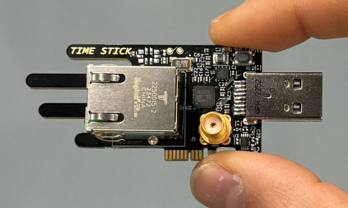
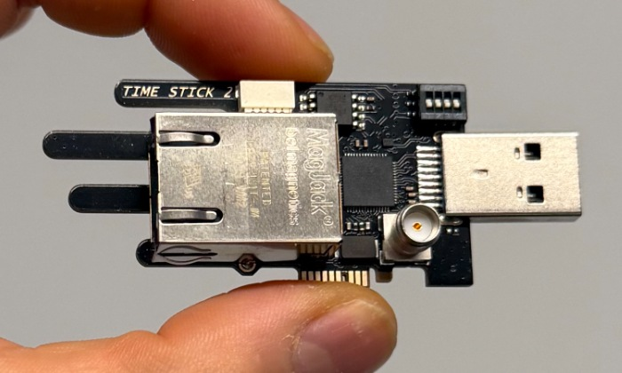
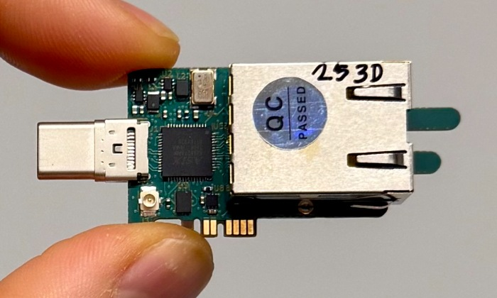

# Time Stick

Time Stick is a family of USB Ethernet adapters for precision timing. The hardware timestamps Precision Time Protocol (PTP) packets as they enter and leave the Ethernet port. With Time Stick V3 and the ISPCS app, you can run a PTP exchange and see the measured clock offset and network path delay.

[Time Stick V3 getting started guide](TimeStick3/README.md)

| [Time Stick V1](TimeStick1/) | [Time Stick V2](TimeStick2/) | [Time Stick V3](TimeStick3/) |
| :---: | :---: | :---: |
|  |  |  |

## Hardware generations

| Generation | Timing features | Resources |
| --- | --- | --- |
| **Time Stick V3** | USB-C timing adapter. Use ISPCS to operate a grandmaster or follower and inspect PTP measurements. | [V3 setup and first measurement](TimeStick3/README.md) |
| **Time Stick V2** | Adds a pulse-per-second (PPS) input and support for a GNSS receiver. | [V2 overview and hardware files](TimeStick2/) · [Linux driver instructions](TimeStick2/DRV/Readme.txt) · [Order V2](https://www.tindie.com/products/timeappliances/time-stick-v2/) |
| **Time Stick V1** | Gigabit Ethernet with hardware timestamps and a PPS output on an SMA connector. | [V1 overview and schematic](TimeStick1/) · [Linux driver instructions](TimeStick1/DRV/Readme.txt) |

## License

See [LICENSE.txt](LICENSE.txt) for the project's Creative Commons Attribution-NonCommercial 4.0 International license. App Store and Google Play badges are trademarks of their respective owners.
