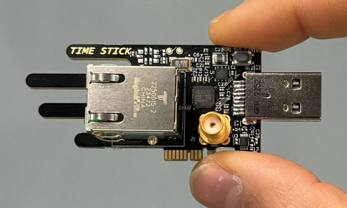

# Time Stick V1

The original Time Stick is a USB 3.2 Gen 1 to Gigabit Ethernet adapter based on the AX88179B. It supports hardware timestamping and brings the pulse-per-second (PPS) output to a female SMA connector.

- [Schematic (PDF)](TimeStick.PDF)
- [ECAD files (ZIP)](ECAD.zip)
- [Linux driver build and installation instructions](DRV/Readme.txt)

[All Time Stick generations](../README.md)
