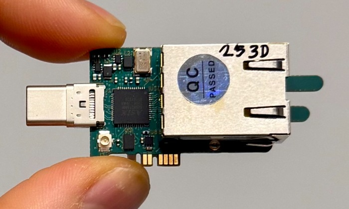

# Time Stick V3

Time Stick V3 connects a USB-C host to an Ethernet timing peer. The stick records hardware timestamps for PTP packets. The ISPCS app uses those timestamps to display the offset between the clocks and the mean path delay.

## Try a two-stick measurement

You will need two V3 sticks with timing firmware, two compatible USB-C hosts running ISPCS, and one Ethernet cable. The following setup uses an iPhone for the follower.

1. Plug a stick into each host. Connect the two sticks directly with the Ethernet cable.
2. On each host, open **Time Stick** in ISPCS, select **Hardware**, and tap **Connect Time Stick**.
3. Select **Grandmaster** on one host and **Follower** on the iPhone. Start the grandmaster, then start the follower. Keep ISPCS open on both hosts during the run.
4. On the follower, look for completed exchanges. **Offset** shows the measured time difference between the clocks. **Mean path delay** estimates the one-way travel time over the Ethernet link.

The stick's firmware determines which roles the app offers. If you only see the simulator, switch to **Hardware** and check that ISPCS identifies the attached stick.

[ISPCS on the App Store](https://apps.apple.com/app/ispcs/id6803257596) · [ISPCS on Google Play](https://play.google.com/store/apps/details?id=org.ispcs.conference) · [All Time Stick generations](../README.md)
